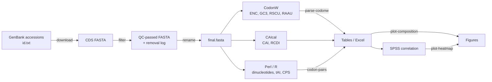

# Codon Usage Pipeline

A reproducible workflow for analysing **codon usage bias in viral coding sequences**, developed during an undergraduate thesis. It combines Python utilities for sequence retrieval, quality filtering, output parsing and figure generation with a documented protocol for established external tools (CodonW, CAIcal, tAI, SPSS).

You can run the whole workflow, or just the parts you need - each step takes plain files in and
writes plain files out.

> This pipeline was originally developed as a Google Colab notebook, now organised as a Python package
> with a command-line interface. External-tool steps remain manual and are documented in
> [`docs/workflow.md`](docs/workflow.md).

## Workflow at a glance



| Stage | Output | Type | Command / location |
|---|---|---|---|
| 1. Download CDS from NCBI | multi-FASTA | automated | `codon-usage download` |
| 2. QC filtering, header renaming | filtered FASTA + log | automated | `codon-usage filter`, `rename` |
| 3. Codon usage indices (ENC, GC3, RSCU, RAAU) | tables | manual (CodonW) + parser | `parse-codonw` |
| 3. CAI, RCDI | per-sequence indices | manual (CAIcal) | `docs/workflow.md` |
| 3. Dinucleotide frequency, tAI, codon pair score, SID | tables | Perl/R/Excel + Python | `r/tai.R`, `codon-pairs` |
| 3. Correlation | coefficient tables | manual (SPSS) | `docs/workflow.md` |
| 4. Figures | PNG | automated | `plot-composition`, `plot-heatmap`, `r/cai_boxplot.R` |

## Use only the part you need

| I want to... | Use |
|---|---|
| Get CDS sequences from accession numbers | `codon-usage download` |
| Clean a CDS FASTA (invalid bases, frame, internal stops) with a log of what was removed | `codon-usage filter` |
| Give sequences short, sequential names (CodonW truncates long headers) | `codon-usage rename` |
| Pull GC_not_GC3s and W/S/R/Y/C/T totals out of CodonW output | `codon-usage parse-codonw` |
| Compare a virus's over-/under-represented codon pairs with human | `codon-usage codon-pairs` |
| Draw a correlation heatmap from an SPSS table | `codon-usage plot-heatmap` |
| Plot composition parameters per gene | `codon-usage plot-composition` |
| Calculate tAI / draw CAI boxplots with Wilcoxon p-values | `r/tai.R`, `r/cai_boxplot.R` |

## Installation

```bash
git clone https://github.com/tazneen-tani/codon-usage-pipeline.git
cd codon-usage-pipeline
python -m venv .venv && source .venv/bin/activate   # Windows: .venv\Scripts\activate
pip install -e .
```

Requires Python 3.9+. The R scripts need `ggplot2`, `reshape2`, `ggsignif`, `ggpubr` and the
[tAI](https://github.com/mariodosreis/tai) package; Perl is needed for the dinucleotide, tAI-matrix
and codon-pair scripts.

## Try it in a minute

`examples/` contains tiny **synthetic** inputs (not real data) for the Python steps:

```bash
bash examples/run_example.sh      # writes to ./results
```

## Quick start with your own data

```bash
codon-usage download data/id.txt --email you@example.com -o all_cds_sequences.fasta
codon-usage filter all_cds_sequences.fasta -o filtered.fasta -m filter_log.csv
codon-usage rename filtered.fasta --prefix VIRUS -o final.fasta
# ... run CodonW / CAIcal (see docs/workflow.md) ...
codon-usage parse-codonw sequence.out -o composition.xlsx
codon-usage codon-pairs --cps cps-tab.csv
codon-usage plot-heatmap spss_correlations.csv --method spearman
```

`codon-usage <command> --help` lists all options.

## Repository layout

```
src/codon_usage/   Python package (download, preprocess, codonw, codon_pairs, plots, cli)
r/                 R scripts (tAI, CAI boxplot with Wilcoxon tests)
examples/          Tiny synthetic inputs and a run script
docs/workflow.md   Full step-by-step protocol, including manual steps
data/              Put your inputs here (git-ignored); third-party resources listed in data/README.md
tests/             Unit tests (pytest)
legacy/            Original Colab export, kept for provenance
```

## Third-party tools

Scripts and files from other sources (CodonW, CAIcal, the Perl scripts, human reference files and
Excel templates) are **available upon request** - see [`data/README.md`](data/README.md).

## Tests

```bash
pip install -e ".[dev]"
pytest
```

## Citing and acknowledgements

Please cite the tools behind each step you use: Biopython (Cock et al., 2009), CodonW (J. Peden),
CAIcal (Puigbò et al., 2008), tAI (dos Reis et al., 2004), codon pair score (Coleman et al., 2008).
To cite this repository, see [`CITATION.cff`](CITATION.cff).

## License

MIT - see [`LICENSE`](LICENSE).

## Author

Tazneen Hossain Tani - [@tazneen-tani](https://github.com/tazneen-tani)
